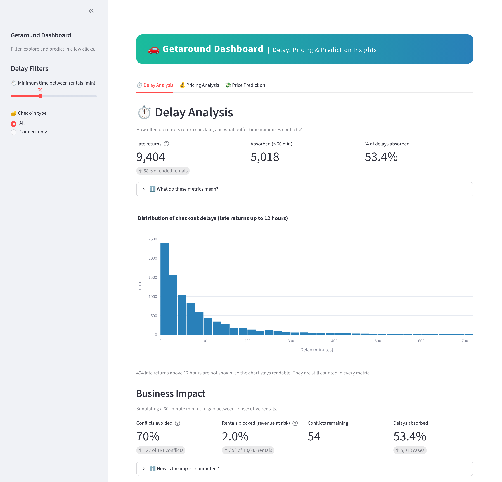

# Getaround: Rental Delay Buffer and Price Prediction

[](https://getaround-pricing.streamlit.app/)
[](https://huggingface.co/spaces/cnoret/getaround-api)
[](https://colab.research.google.com/github/cnoret/getaround-pricing/blob/main/notebooks/eda_delay.ipynb)
[](https://github.com/cnoret/getaround-pricing/actions/workflows/tests.yml)


**How long should a car rest between two rentals, and what should it cost per day?** On 21,310 Getaround rentals, a 60-minute minimum gap prevents **70% of late-return conflicts** while blocking only **2.0% of rentals**. A Random Forest prices a car within **€10.7 on average**, half the error of a median-price baseline (€23.2). Delivered as a Streamlit dashboard and a FastAPI prediction service.

**Data:** 21,310 rentals · 8,143 cars · 2 check-in flows (mobile, Connect) · 58% of ended rentals returned late · 4,843 car listings · 28 brands · median price €119/day

**Live app:** [getaround-pricing.streamlit.app](https://getaround-pricing.streamlit.app/) · API: [Hugging Face Space](https://huggingface.co/spaces/cnoret/getaround-api)



---

## The business questions

Getaround lets drivers rent cars from owners for a few hours to a few days. Late returns cause friction: when a car comes back late and another driver booked it right after, the next rental starts late or gets canceled. The product team considers a **minimum gap between two rentals of the same car**, which raises two questions:

1. **Threshold:** how long should the gap be, knowing that every booking it prevents is lost revenue for the owner and for Getaround?
2. **Scope:** should it apply to all cars, or only to Connect cars (opened with the driver's phone, without meeting the owner)?

A second dataset of car listings feeds a pricing model, so owners can get a suggested daily price.

## Key findings

### Minimum gap between rentals

A **conflict** is a rental whose previous rental, on the same car, came back later than the planned gap. A buffer of *N* minutes blocks every booking planned less than *N* minutes after the previous one: it removes the conflicts on those bookings, and the bookings themselves.

| Buffer | Conflicts avoided (all cars) | Rentals blocked (all cars) | Conflicts avoided (Connect) | Rentals blocked (Connect) |
|--------|------------------------------|----------------------------|-----------------------------|---------------------------|
| 30 min | 55% | 1.4% | 60% | 3.1% |
| **60 min** | **70%** (127 of 181) | **2.0%** (358 of 18,045) | **76%** (38 of 50) | **4.4%** |
| 90 min | 82% | 2.9% | 88% | 6.3% |
| 120 min | 86% | 3.3% | 92% | 7.2% |

- **58% of ended rentals are returned late** (9,404 of 16,345 with a known delay), but conflicts are rare: only 1,612 ended rentals were booked less than 12 hours after the previous rental of the same car, and 181 of them were hit by a late return.
- **60 minutes is the knee of the curve**: it avoids most conflicts for 2% of rentals. Going to 120 minutes adds 15 points of avoided conflicts but blocks 65% more rentals.
- **Connect cars carry a higher cost**: 19% of their rentals follow another one within 12 hours (6% for mobile check-in), so the same buffer blocks twice the share of their rentals (4.4% vs. 2.0%) for a few more points of conflicts avoided (76% vs. 70%).
- All figures use the **raw rental export**: missing delays are left out and long delays are kept as they are, so no conflict is hidden by cleaning.

### Price prediction

| Metric (20% holdout) | Random Forest | Median-price baseline |
|----------------------|---------------|-----------------------|
| MAE  | €10.68 | €23.20 |
| RMSE | €16.73 | |
| R²   | 0.734  | |

Engine power, car type and brand drive the price. StandardScaler on numeric features (mileage, engine power), OneHotEncoder on categoricals (brand, fuel, color, car type), Random Forest of 100 trees, `random_state=42`.

---

## What's inside

| Part | Content |
|------|---------|
| **Dashboard** (Streamlit · Plotly) | *Delay Analysis*: late-return distribution, buffer simulation with a threshold slider and a Connect-only filter, conflicts avoided vs. rentals blocked. *Pricing Analysis*: KPIs and price distributions by mileage, fuel and car type. *Price Prediction*: form wired to the API, estimate vs. platform average. If the API does not answer, the dashboard falls back to the same saved model, so the form always works. |
| **API** (FastAPI · Pydantic v2) | `POST /predict` for one or several cars, `GET /health`, Swagger UI at `/docs`. Every categorical field is a `Literal`, numeric fields have bounds. |
| **Training** (scikit-learn · MLflow) | `ml/model_training.py` trains the pipeline, logs metrics and the model to MLflow, and saves `ml/model/model.joblib`. |
| **Notebooks** | [eda_delay.ipynb](notebooks/eda_delay.ipynb): delay distribution, missing values, outliers. [eda_pricing.ipynb](notebooks/eda_pricing.ipynb): pricing distributions and correlations. |

## Tech stack

| Layer | Libraries |
|-------|-----------|
| Data | Pandas · openpyxl |
| ML | scikit-learn (RandomForest, Pipeline, ColumnTransformer) · Joblib |
| Experiment tracking | MLflow |
| API | FastAPI · Pydantic v2 · Uvicorn |
| Dashboard | Streamlit · Plotly |
| Quality | pytest · Streamlit AppTest · ruff · GitHub Actions |
| Infra | Docker · Docker Compose · Streamlit Community Cloud · Hugging Face Spaces |

---

## Quick start

```bash
docker compose up --build
```

| Service | URL |
|---------|-----|
| Dashboard | [localhost:8501](http://localhost:8501) |
| API + Swagger UI | [localhost:8001/docs](http://localhost:8001/docs) |
| MLflow UI | [localhost:5001](http://localhost:5001) |

Docker Compose trains the model first (`condition: service_completed_successfully`), then starts the API and the dashboard, which reaches the API through the `API_URL` environment variable. Without `API_URL`, the dashboard predicts with `ml/model/model.joblib` directly.

### Run locally without Docker

```bash
git clone https://github.com/cnoret/getaround-pricing.git
cd getaround-pricing
pip install -r requirements-dev.txt

# Terminal 1: API
uvicorn api.main:app --reload --port 8001

# Terminal 2: dashboard
streamlit run dashboard/app.py --server.port=8501
```

### Deployment

- **Dashboard:** Streamlit Community Cloud, from this repo (`dashboard/app.py`, Python 3.12), redeployed on every push to `main`. The `API_URL` secret points it to the API Space.
- **API:** Hugging Face Space (Docker), [cnoret/getaround-api](https://huggingface.co/spaces/cnoret/getaround-api).

### Tests

```bash
pip install -r requirements-dev.txt
ruff check .
python -m pytest
```

45 tests in about 30 seconds: API routes and validation (with a mocked model), a sanity check of the saved model, the buffer simulation on synthetic and real data (including the figures quoted above), and the dashboard run with Streamlit AppTest for every filter and for the prediction form (through the API, with the local model, and with the API down). The **Tests** workflow runs `pip check`, ruff and pytest on Python 3.12 on every push and pull request.

### Retrain

```bash
pip install -r ml/requirements.txt
python ml/model_training.py
```

Metrics and artifacts are tracked in MLflow (`./mlruns`).

---

## Project structure

```text
.
├── api/                     # FastAPI prediction API
│   ├── main.py
│   └── requirements.txt
├── dashboard/               # Streamlit dashboard
│   ├── app.py               # Layout and charts
│   ├── delay.py             # Late returns and buffer simulation
│   └── requirements.txt
├── data/
│   ├── get_around_delay_analysis_base.xlsx   # Raw rental export + field documentation
│   ├── get_around_delay_analysis.csv         # Cleaned by eda_delay.ipynb (EDA only)
│   └── get_around_pricing_project.csv
├── ml/
│   ├── model/model.joblib
│   ├── model_training.py
│   └── requirements.txt
├── notebooks/               # Exploratory data analysis
├── tests/                   # pytest + Streamlit AppTest
├── .github/workflows/tests.yml
├── Dockerfile.dashboard · Dockerfile.fastapi · Dockerfile.training
├── docker-compose.yml
├── requirements-dev.txt · pytest.ini · ruff.toml
└── LICENSE
```

---

## License

MIT, see [LICENSE](LICENSE).
